<a href="https://vinicius.cardozo.io">
  <picture>
    <source media="(prefers-color-scheme: dark)" srcset="assets/hero-dark.svg">
    <source media="(prefers-color-scheme: light)" srcset="assets/hero-light.svg">
    
  </picture>
</a>

  
  
  

  I'm <b>@cardozov</b>, passionate about software development as a way to solve real-life problems.
   
  <b>Feel free to reach out to me about other subjects as well.</b>

<picture>
  <source media="(prefers-color-scheme: dark)" srcset="assets/roles-dark.svg">
  <source media="(prefers-color-scheme: light)" srcset="assets/roles-light.svg">
  
</picture>

<picture>
  <source media="(prefers-color-scheme: dark)" srcset="assets/langs-dark.svg">
  <source media="(prefers-color-scheme: light)" srcset="assets/langs-light.svg">
  
</picture>

<picture>
  <source media="(prefers-color-scheme: dark)" srcset="assets/footer-dark.svg">
  <source media="(prefers-color-scheme: light)" srcset="assets/footer-light.svg">
  
</picture>

  

