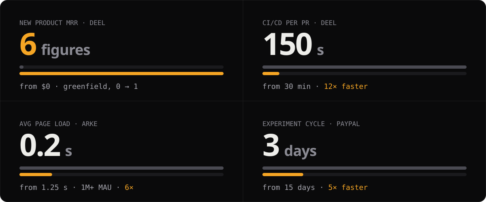
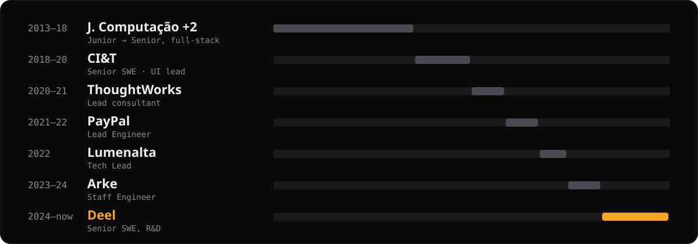

I've been building software since 2013, in fintech, HR tech and enterprise, at places like PayPal, ThoughtWorks and now Deel. Most of the work I'm proud of shows up in a metric: more revenue, less waiting.

**[vinicius.cardozo.io ↗](https://vinicius.cardozo.io)** &nbsp;·&nbsp; [Résumé](https://vinicius.cardozo.io/Resume.pdf) &nbsp;·&nbsp; [LinkedIn](https://www.linkedin.com/in/vcardozo/) &nbsp;·&nbsp; [Book 20 min](https://cal.com/vinicius-cardozo-ugp9uv/20min)

### `01` Impact ledger

Shipped with teams at Deel · PayPal · ThoughtWorks · CI&T · Arke · Lumenalta

### `02` Case files

- **[Zero to 6-figure MRR on a greenfield product](https://vinicius.cardozo.io/#/case/deel)** · Deel R&D · 2024–now 
  A new R&D product: an HR plugin that lives inside Slack and Microsoft Teams, started from scratch at a company that was growing fast. 
  → **$0 → 6-figure MRR · PR pipeline 30 min → 150 s**
- **Experiment cycles: 15 → 3 days** · PayPal · Lead Engineer · 2021–22 
  Led a group of backend, frontend and mobile engineers. We automated the deployment pipeline end to end and built a multi-factor logging service, so product could read experiment results in days instead of weeks.
- **6× faster on 1M+ MAU platforms** · Arke · Staff Engineer · 2023–24 
  Mapped every request on the critical path, removed the ones we didn't need, lazy-loaded the rest and rebuilt key components to work offline first. Average load went from 1.25 s to 0.2 s, and deploy time dropped 33%.

Full write-ups, with the architecture diagram and decisions, on **[the site](https://vinicius.cardozo.io/#work)**.

### `03` Teaching

- [React com TailwindCSS: estilizando componentes](https://www.alura.com.br/curso-online-react-tailwindcss-estilizando-componentes) · Alura
- [React: criando um Design System com TailwindCSS](https://www.alura.com.br/curso-online-react-criando-design-system-tailwind) · Alura
- [Utilizando Swagger para documentar API Node e Express](https://app.rocketseat.com.br/jornada/plus/sala/creators/aula/utilizando-swagger-para-documentar-api-node-e-express/visao-geral) · Rocketseat

Published in Portuguese (PT-BR)

### `04` Trajectory

Postgrad · Leadership & People Mgmt · 2024 · Postgrad · Cloud Computing · 2023 · BSc · Computer Engineering · 2018

---

Open to talk · Brazil · UTC−3 · PT · ES · EN · <a href="mailto:vinicius.gcardozo@gmail.com">vinicius.gcardozo@gmail.com</a>
